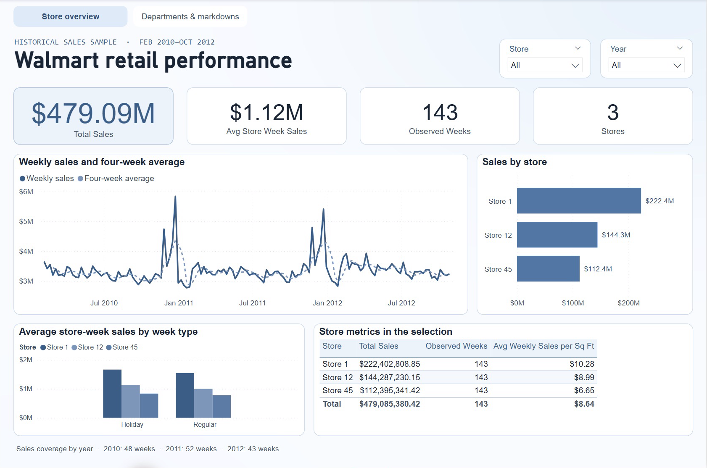
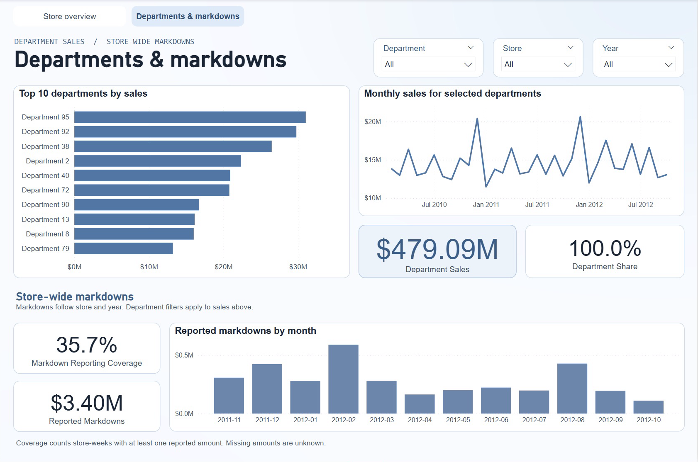

# Walmart Retail Sales | MySQL + Power BI

A retail sales analysis of three stores from February 2010 through October 2012. The Power BI report explores $479.09M in recorded sales across 143 observed weeks.

## Store overview



Use the store and year filters to compare weekly sales, the four-week moving average and sales per square foot.

## Departments & markdowns



Compare department sales and share within the selected store and year. The markdown section reports store-wide amounts and reporting coverage. Its measures respond to store and year.

## SQL workflow

1. **Validate the source.** The Python loader checks store and department keys, dates and holiday labels in five CSV files.
2. **Build the MySQL model.** The schema and views keep department-week sales separate from store-week features and markdowns. The views calculate weekly sales, sales per square foot and a four-week moving average.
3. **Reconcile and export.** Six SQL checks cover join integrity, coverage and totals. The loader reconciles the original sales total against MySQL and the CSVs written for Power BI.
4. **Refresh the report.** Power BI imports the exports into a model with Store, Week and Department dimensions. Store and Week filter both fact tables, while Department filters the sales fact at department-week grain.

The historical sample contains 29,586 department-week sales records and 429 store-week sales totals. It covers 48 weeks in 2010, 52 in 2011 and 43 in 2012. Annual totals reflect those observed periods. Missing markdown amounts indicate missing reporting, and holiday or markdown comparisons describe associations within the sample.

## Reproduce the report

The steps below describe the build used for the screenshots. They require the original CSVs and the SQL-to-Power-BI project files, which are kept separately from this screenshot release.

1. Install Python 3, MySQL 8.0 or later with its client, and Power BI Desktop on Windows. Use a dedicated MySQL database for this project.
2. Put `stores.csv`, `store_features.csv`, `store 1.csv`, `store 12.csv` and `Store 45.csv` in one directory.
3. From the project root, run:

   ```bash
   python3 scripts/build_bi.py --data-dir /path/to/source-csvs
   ```

4. Open `powerbi/Walmart Retail.pbip` in Power BI Desktop, keeping the two neighboring project folders with it. In **Transform data → Manage Parameters**, set `ExportFolder` to the Windows-accessible path to the generated `data/exports` directory. Select **Close & Apply** and **Refresh**.
5. With all slicers cleared, confirm that **Store overview** shows **$479.09M** in sales, **143** observed weeks and **3** stores. For **Departments & markdowns**, confirm the all-department sales total and **35.7%** markdown reporting coverage.

## Original SQL analysis

The project began as a group assignment for ITC 295 at Missouri State University. The SQL-to-Power-BI pipeline and report are my post-course extension. The [original SQL scripts](sql/) and their recorded results document the earlier analysis.

- Store 1 had the highest sales and sales per square foot in all three observed years. In 2011, it recorded $80.92M and $534.79 per square foot.
- Holiday weeks had higher average department-week sales at each store. Store 1 averaged $23,039.39 on holiday weeks and $21,609.63 on other weeks.
- Weeks with reported promotional markdowns had higher average store-week sales at each store in the original comparison. The Super Bowl analysis compares one selected week with the preceding week.

<details>
<summary>View the original SQL result screenshots</summary>

- [Store overview](assets/screenshots/analysis1_store_overview.png)
- [Yearly sales and sales per square foot](assets/screenshots/analysis2_yearly_sales_efficiency.png)
- [Holiday and non-holiday sales](assets/screenshots/analysis3_holiday_vs_nonholiday.png)
- [Average markdown and sales](assets/screenshots/analysis4_avg_markdown_vs_sales.png)
- [Sales by promotion reporting status](assets/screenshots/analysis4_promotion_vs_no_promotion.png)
- [Super Bowl department comparison](assets/screenshots/analysis5_superbowl_department_comparison.png)

</details>
