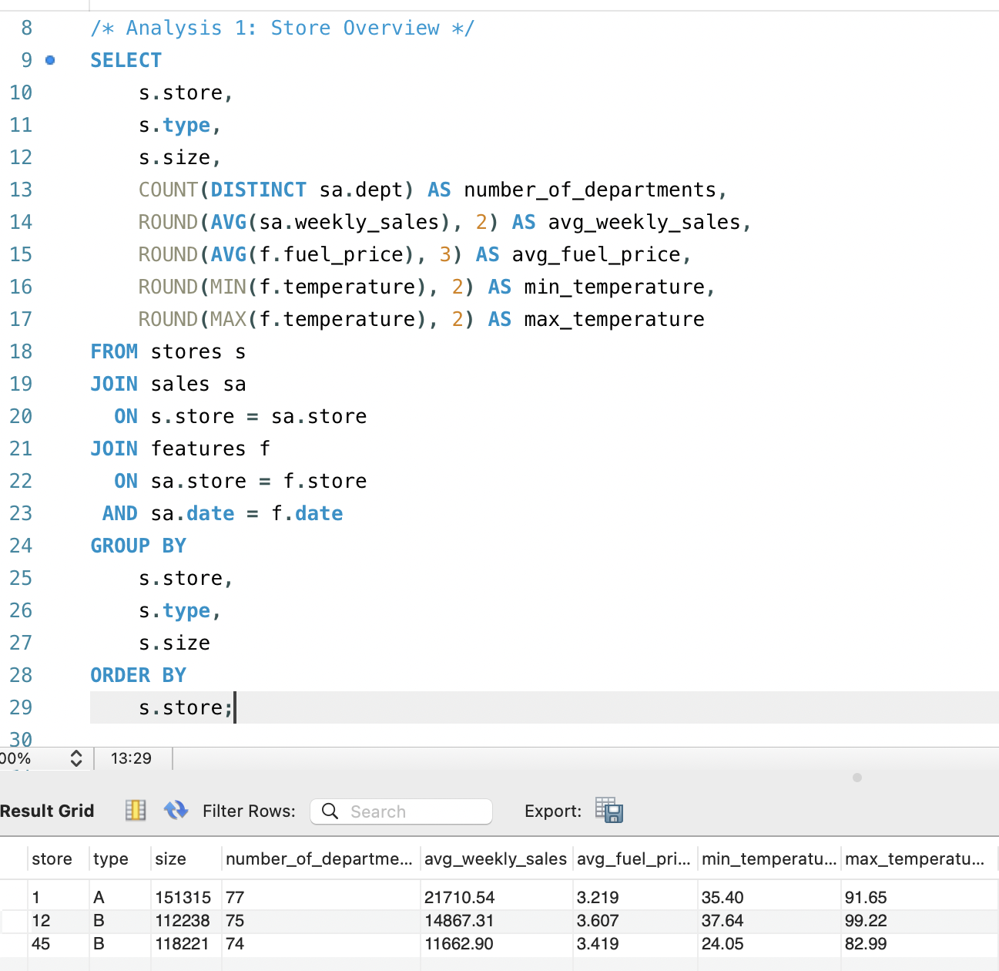
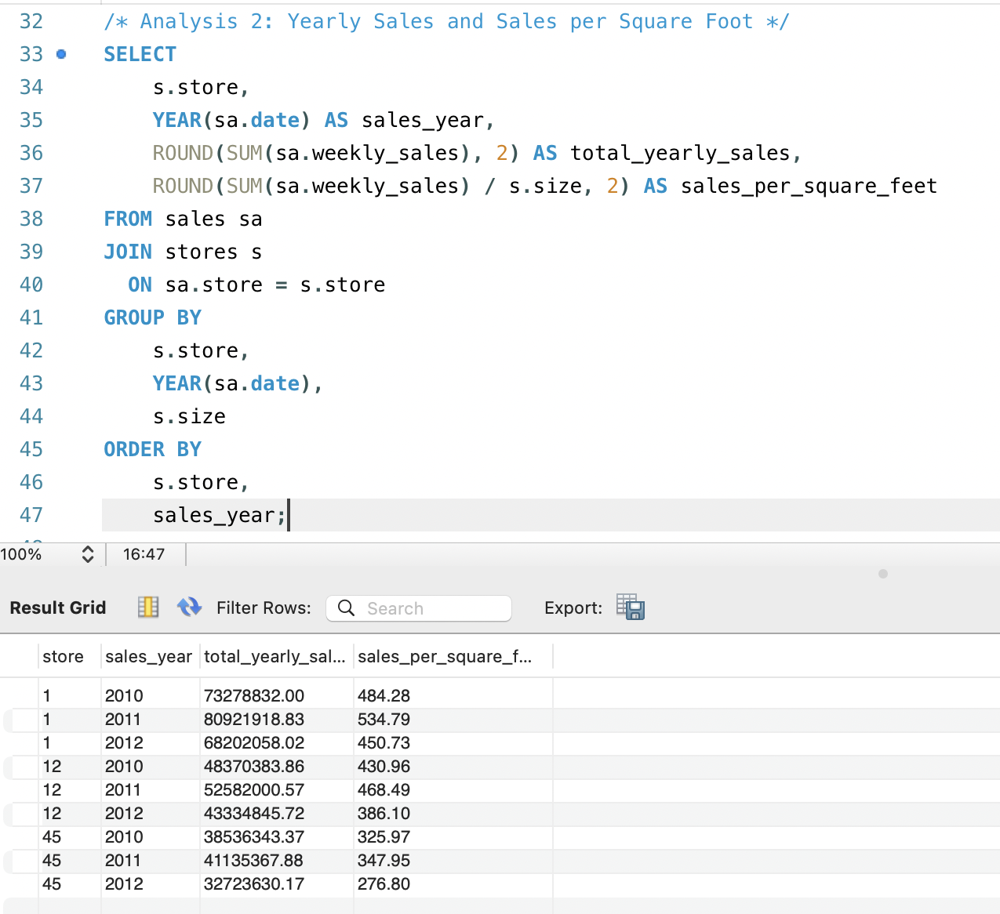
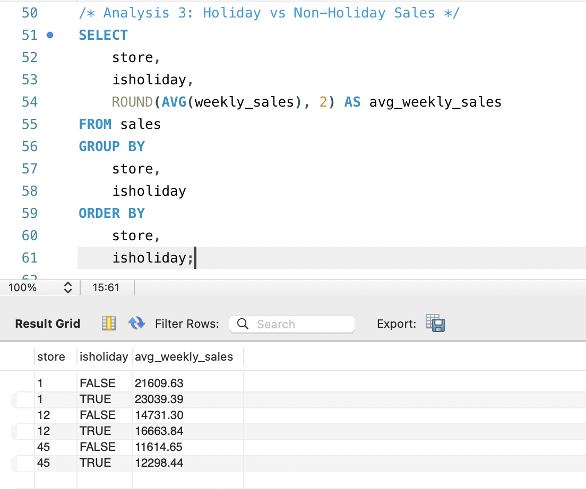
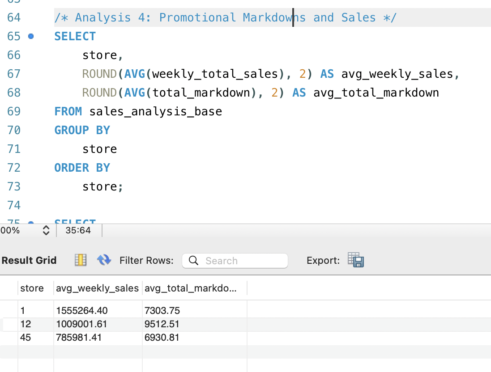
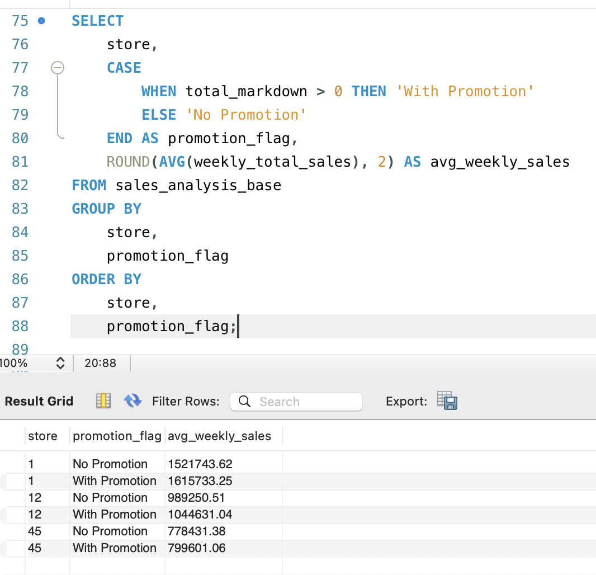
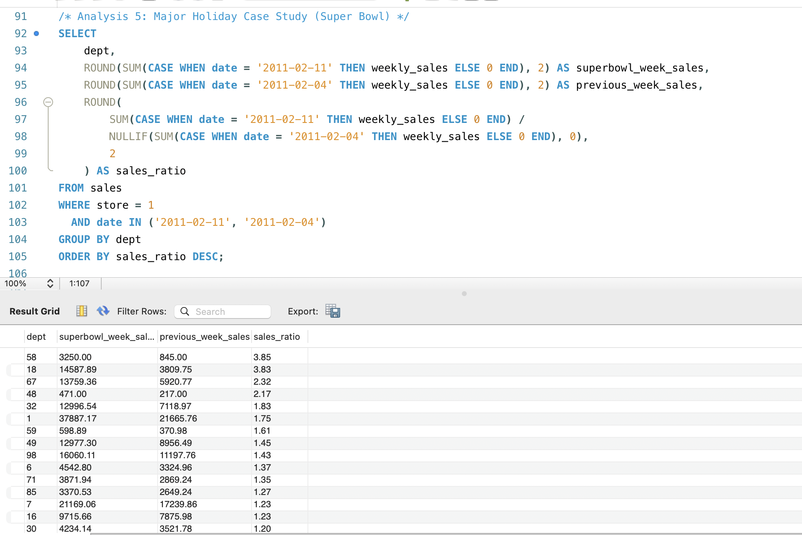

# Retail Sales Analysis: Impact of Holidays and Promotional Markdowns

## Project Summary
This project analyzes historical retail sales data to evaluate how holidays and promotional markdowns influence weekly sales performance across stores and departments. Using SQL, the analysis focuses on sales efficiency, seasonal demand patterns, promotional effectiveness, and department-level holiday behavior.

## Dataset
- Weekly sales data from three retail stores (2010–2012)
- Store attributes including size and type
- Promotional markdown activity and holiday indicators
- External factors such as temperature and fuel prices

## Key Questions
- How do store size and type relate to average weekly sales?
- Which stores generate the highest yearly sales and sales per square foot?
- Do holiday weeks outperform non-holiday weeks in sales?
- How are promotional markdowns associated with weekly sales?
- Do major holidays drive uniform sales increases across departments?

## Key Findings
- Larger stores consistently outperform smaller stores in both total sales and sales efficiency.
- Holiday weeks generate higher average sales across all stores.
- Promotional markdowns are positively associated with higher weekly sales.
- Major holidays drive sales increases in specific departments rather than across the entire store.

## Tools & Skills
- SQL (joins, aggregations, subqueries, views)
- Data cleaning and transformation
- Business-oriented analytical reasoning
- Retail and promotional performance analysis

## Project Context
This project originated as a group coursework assignment for ITC 295 at Missouri State University.

The version presented here reflects my individual contributions and post-course refinements, including query restructuring, data cleaning, and analytical interpretation.

## Repository and execution guide

The SQL uses MySQL syntax. Run it only in a dedicated project database: the setup and cleaning scripts recreate or truncate project tables.

1. Run `sql/01_create_tables.sql` to create the database and final tables.
2. Run section A of `sql/02_load_and_clean.sql` to create the staging tables.
3. Import the original CSVs into `stores_raw`, `store_features_raw`, `store1_raw`, `store12_raw` and `store45_raw` using matching column order.
4. Run sections B and C of that file to clean the staging data, populate final tables and build views.
5. Run `sql/03_analysis_queries.sql` to reproduce the analyses.

The source CSVs are not included. Screenshots below preserve the recorded query results; a fresh data run requires the original files.

## Interpretation limits

The sample covers three stores, so results should not be generalized to the full retailer. Holiday and promotion comparisons are descriptive associations, without causal controls. Queries 1 and 3 average store-department-week rows; queries using `weekly_store_sales` aggregate departments to store-week totals. These grains should not be treated as interchangeable.

## Analysis Results

### Analysis 1: Store Overview

### Analysis 2: Yearly Sales and Sales per Square Foot

### Analysis 3: Holiday vs Non-Holiday Sales

### Analysis 4: Promotional Markdowns and Sales

### Analysis 5: Major Holiday Case Study – Super Bowl

